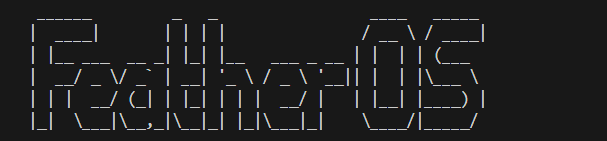
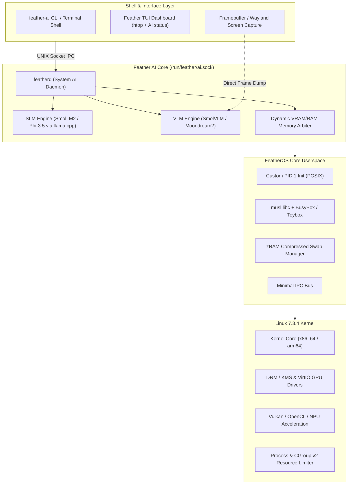
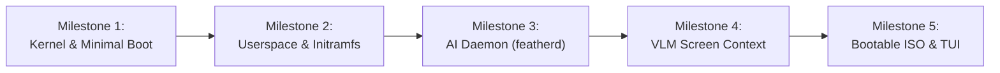

<p align="center">
  
</p>

```text
  ______         _   _                 ____   _____ 
 |  ____|       | | | |               / __ \ / ____|
 | |__ ___  __ _| |_| |__   ___ _ __ | |  | | (___  
 |  __/ _ \/ _` | __| '_ \ / _ \ '__|| |  | |\___ \ 
 | | |  __/ (_| | |_| | | |  __/ |   | |__| |____) |
 |_|  \___|\__,_|\__|_| |_|\___|_|    \____/|_____/ 
```

<div align="center">

# FeatherOS

**AI-Native, Hyper-Efficient Linux Distribution**

[](https://opensource.org/licenses/GPL-2.0)
[](https://kernel.org)
[](#)
[](#)

</div>

> **Vision:** A featherweight, hyper-efficient Linux distribution engineered from the ground up to integrate Small Language Models (SLMs) and Vision-Language Models (VLMs) directly into the core operating system.

---

## 1. Architectural Overview

FeatherOS replaces the traditional bloated distribution stack with a streamlined, AI-native layered architecture:



---

## 2. The Core Tenets of FeatherOS

| Tenet | Description | Target Specification |
| :--- | :--- | :--- |
| **Featherweight Footprint** | Extremely low idle overhead to reserve maximum system memory and compute for models. | **< 45 MB RAM** idle (without models), **< 250 MB RAM** with 135M SLM resident. |
| **Sub-Second Boot** | Direct kernel boot into a custom initramfs with zero legacy service overhead. | **< 1.2s** from bootloader to interactive shell. |
| **System-Level AI IPC** | AI is not an app; it is a system service accessible to scripts, pipes, and shell commands. | `/run/feather/ai.sock` UNIX domain socket with streaming JSON-RPC. |
| **Screen-Aware Intelligence** | Native VLM pipelines that inspect the terminal or framebuffer to diagnose errors and assist users. | Direct `/dev/fb0` or DRM dumb buffer capture into VLM context. |
| **Deterministic Control** | AI proposes and assists, but never modifies critical system state without user consent. | Dual-mode execution: `feather-ai ask` vs `feather-ai run --confirm`. |

---

## 3. Deep Dive: The AI Subsystem (`featherd`)

The heart of FeatherOS is `featherd`, an ultra-lightweight daemon written in C/C++ on top of `llama.cpp`:

### A. Small Language Model (SLM) Integration

- **Default Resident Model:** `SmolLM2-135M-Instruct` or `Qwen2.5-0.5B-Instruct` (Q4_K_M quantized).
- **RAM Footprint:** ~80–180 MB.
- **Roles:**
  - **Natural Language Terminal Interface:** Translate plain English queries into valid shell pipelines (e.g., `feather-ai "find all logs modified today containing error"`).
  - **Automated Error Diagnosis:** Intercept non-zero exit codes in bash/zsh and explain root causes.
  - **System Health Summarization:** Analyze `dmesg`, `journal`, and system metrics into human summaries.

### B. Vision-Language Model (VLM) Integration

- **Default On-Demand Model:** `SmolVLM-500M-Instruct` or `Moondream2` (Q4_K_M quantized).
- **RAM Footprint:** ~350–550 MB (loaded dynamically or kept warm if VRAM permits).
- **Roles:**
  - **Screen Inspector:** Capture the current terminal or display buffer to answer: *"What is failing in this compilation output?"* or *"Describe what is shown on screen."*
  - **Visual Accessibility:** Generate instant audio or text descriptions of graphical elements.

### C. Socket API Specification

Any program (C, Python, Shell, Rust) interacts with the AI service via `/run/feather/ai.sock`:

```json
// Request
{
  "action": "infer",
  "model_type": "slm",
  "temperature": 0.2,
  "messages": [
    {"role": "system", "content": "You are the FeatherOS system assistant. Output concise POSIX commands."},
    {"role": "user", "content": "Show free disk space in human readable format"}
  ]
}

// Response Stream
{"token": "df", "done": false}
{"token": " -h", "done": false}
{"token": "", "done": true}
```

---

## 4. Hardware & Resource Budget

```
+-------------------------------------------------------------+
|                      System RAM (4 GB Total)                |
+-------------------------------------------------------------+
| OS Base & Kernel:   ~45 MB                                  |
| Resident SLM (135M): ~95 MB                                 |
| zRAM Swap Cache:    ~512 MB (compressed 2:1 memory reserve) |
| Available for Apps: ~3,350 MB                               |
+-------------------------------------------------------------+
```

1. **Hardware Acceleration:**
   - **Vulkan / DRM:** Primary cross-platform acceleration for integrated graphics (Intel Iris, AMD Radeon, VirtIO-GPU).
   - **CPU Fallback:** Multi-threaded AVX2 / AVX-512 / ARM NEON vector instructions ensure snappy inference even without dedicated GPUs.
2. **Memory Management:**
   - Linux `zRAM` enabled by default to compress in-memory model weights when idle.
   - Dynamic model swapping: VLM models unload automatically after 60 seconds of inactivity to reclaim RAM.

---

## 5. Implementation Roadmap



1. **Milestone 1 — Kernel Foundation:** Configure and compile Linux 7.3.4 into a lean `bzImage` with zRAM, DRM, and VirtIO support.
2. **Milestone 2 — Featherweight Base:** Build a Musl + BusyBox rootfs with our custom `/init` script, tested in QEMU.
3. **Milestone 3 — AI Daemon & CLI:** Implement `featherd` and the `feather-ai` client using quantized GGUF models.
4. **Milestone 4 — VLM & Vision Pipeline:** Add framebuffer visual capture and multimodal reasoning.
5. **Milestone 5 — Full Packaging:** Produce a bootable hybrid ISO with an installer and FeatherOS TUI dashboard.
